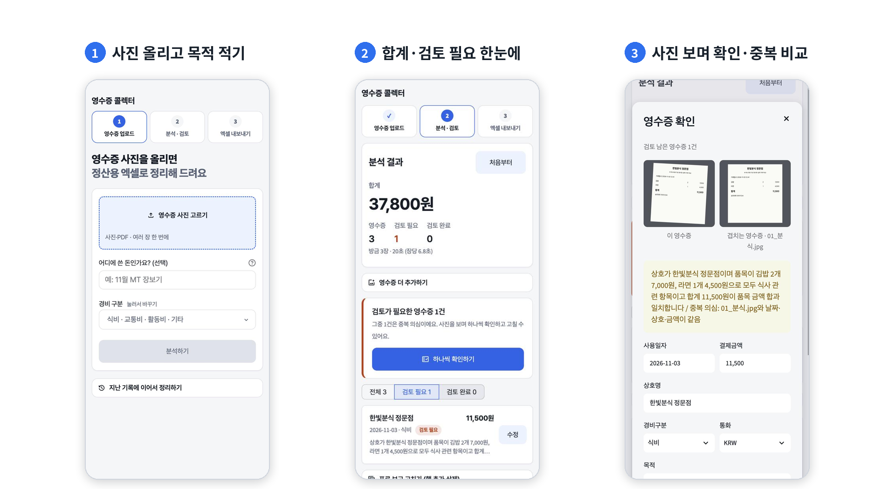
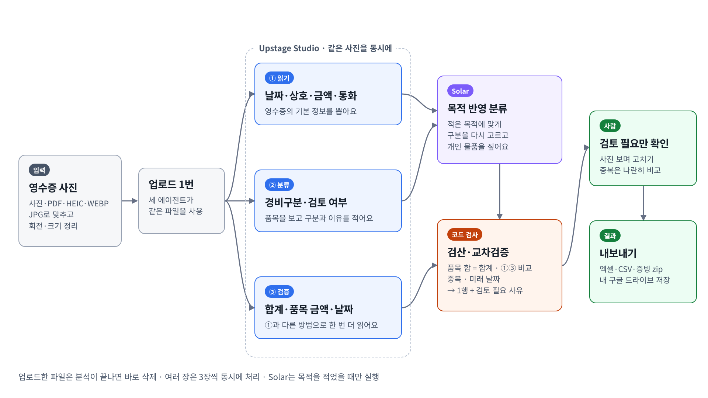
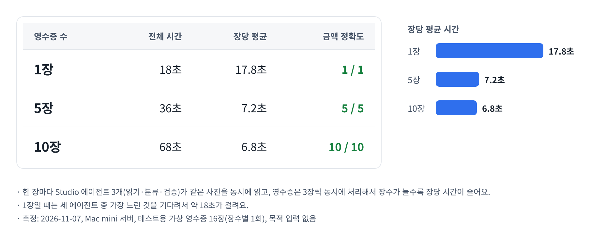
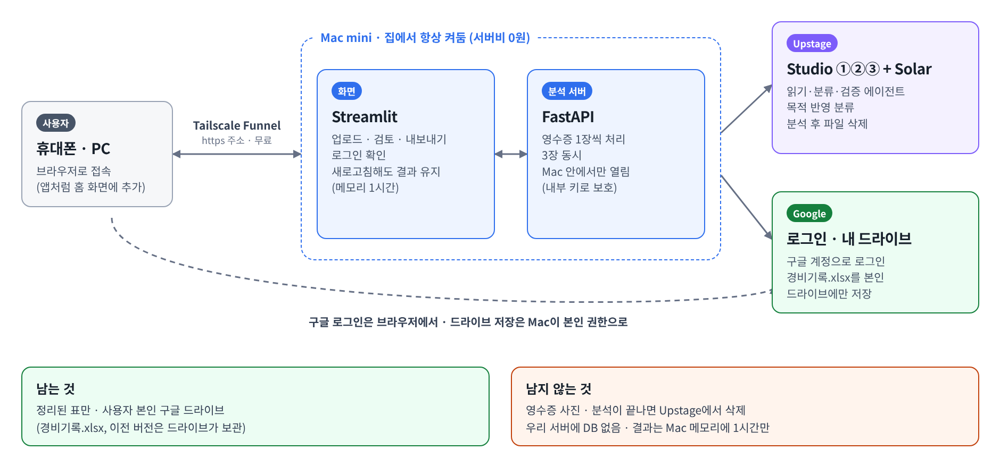

<div align="center">

# 🧾 영수증 콜렉터

**영수증 사진만 올리면, 확인이 필요한 것만 표시된 경비 엑셀이 나옵니다.**

Upstage Studio 에이전트 3개가 같은 영수증을 동시에 읽고, 코드로 한 번 더 검산합니다.<br>
사람은 '검토 필요'로 표시된 영수증만 사진을 보며 확인하면 됩니다.


전남대학교 × Upstage AI Education · Studio 활용 프로젝트 **2조**

</div>

<br>



## 목차

1. [왜 만들었나](#왜-만들었나)
2. [주요 기능](#주요-기능)
3. [처리 흐름](#처리-흐름)
4. [AI가 틀릴 때 잡는 장치](#ai가-틀릴-때-잡는-장치)
5. [속도와 정확도](#속도와-정확도)
6. [시스템 구성](#시스템-구성)
7. [실행 방법](#실행-방법)
8. [폴더 구조](#폴더-구조)
9. [향후 계획](#향후-계획)

---

## 왜 만들었나

동아리·학생회·행사 운영진은 개인카드로 먼저 결제하고, 행사가 끝나면 영수증을 모아 정산을 받습니다.

- 영수증 사진을 하나씩 보며 **날짜·상호명·금액을 엑셀에 직접 옮겨 적어야** 합니다.
- 식비·교통비 같은 **경비 구분을 사람마다 다르게** 판단합니다.
- 금액 오타나 **같은 영수증 중복 제출**은 정산 담당자가 다시 찾아야 합니다.

영수증 콜렉터는 이 일을 **'입력하는 일'에서 '확인만 하는 일'로** 바꿉니다.

## 주요 기능

| | 기능 | 설명 |
|---|---|---|
| 📤 | **여러 장 한 번에 올리기** | 사진(JPG·PNG·HEIC·WEBP)과 PDF를 함께 올립니다. 아이폰 HEIC·안드로이드 WEBP 변환, 누운 사진 회전, 큰 사진 축소를 자동으로 합니다. |
| 🎯 | **목적에 맞춘 경비 구분** | "11월 MT 장보기"처럼 목적을 적으면 그 목적에 맞게 경비 구분을 고르고, 목적과 맞지 않는 개인 물품을 짚어 줍니다. 경비 구분 목록은 팀 기준으로 바꿀 수 있습니다. |
| ✅ | **검토 필요만 골라 보기** | 문제가 있는 영수증에만 '검토 필요'와 사유를 붙입니다. PC에서는 사진을 왼쪽에 두고 오른쪽에서 고칩니다. |
| 👯 | **중복 영수증 나란히 비교** | 같은 파일이거나 날짜·상호·금액이 같은 영수증을 두 사진 나란히 보여 주고, 버튼 하나로 뺍니다. |
| 📊 | **원하는 모양으로 내보내기** | 넣을 칸·순서·칸 이름을 고르고 표를 미리 본 뒤 받습니다. 엑셀(경비구분별 합계 시트 포함)·CSV, 엑셀 행 번호에 맞춰 이름 붙인 **증빙 사진 zip**까지 받을 수 있습니다. |
| ☁️ | **내 구글 드라이브에 저장** | 구글로 로그인하면 `내 드라이브/영수증 콜렉터/경비기록.xlsx`에 저장하고, 다음 행사 때 이어서 정리합니다. |
| 📱 | **휴대폰에서 바로** | 휴대폰 화면에 맞춘 디자인, 다크 모드, 홈 화면에 앱처럼 추가할 수 있습니다. 새로고침해도 결과가 남습니다. |

## 처리 흐름



영수증 한 장마다 파일을 **한 번만 올리고**, 세 에이전트가 같은 파일을 **동시에** 읽습니다. 여러 장은 3장씩 동시에 처리합니다.

| 단계 | 담당 | 하는 일 |
|---|---|---|
| ① 읽기 | Upstage Studio 워크플로우 | 사용일자·상호명·결제금액·통화 추출 |
| ② 분류 | Upstage Studio 워크플로우 | 품목을 보고 경비 구분·검토 필요 여부·사유 판단 |
| ③ 검증 | Upstage Studio 워크플로우 | 합계·품목별 금액·날짜를 ①과 다른 방법으로 한 번 더 읽기 |
| 목적 반영 | Upstage Solar | 사용자가 적은 목적에 맞게 경비 구분을 다시 고르고 개인 물품 확인 (목적을 적었을 때만) |
| 코드 검사 | Python | 검산·교차검증·중복·미래 날짜 확인 → 1장당 1행 + '검토 필요' 사유 |

> Studio 워크플로우는 파일로만 시작할 수 있어서, 글(목적·경비 구분 목록)이 필요한 목적 반영 단계는 Solar 모델을 직접 부릅니다.

## AI가 틀릴 때 잡는 장치

AI 결과를 그대로 믿지 않고, 틀릴 수 있는 곳을 숨기지 않고 표시합니다.

| 장치 | 방법 |
|---|---|
| **품목 합 검산** | 품목 금액을 더해 합계와 비교합니다. 다르면 '검토 필요'와 함께 "품목을 빠뜨려 읽었을 수 있어요" 같은 사유를 적습니다. |
| **①③ 교차검증** | ①읽기와 ③검증이 같은 사진을 따로 읽어, 금액·날짜가 다르면 표시합니다. |
| **중복 감지** | 같은 파일(내용 해시) 또는 날짜·상호·금액이 같은 영수증을 찾아 나란히 보여 줍니다. |
| **미래 날짜** | 오늘 이후 날짜로 읽힌 영수증을 표시합니다. |
| **목적 부합** | 목적과 맞지 않는 개인 물품이 섞여 있으면 품목과 금액을 사유에 적습니다. |

**실제로 잡은 사례:** 품목 한 줄(800원)을 빠뜨려 읽은 영수증을 품목 합 ≠ 합계로 찾아 '검토 필요'로 표시했습니다.

## 속도와 정확도



| 영수증 수 | 전체 시간 | 장당 평균 | 금액 일치 |
|---:|---:|---:|---:|
| 1장 | 18초 | 17.8초 | 1 / 1 |
| 5장 | 36초 | 7.2초 | 5 / 5 |
| 10장 | 68초 | 6.8초 | 10 / 10 |

<sub>측정: 2026-11-07, Mac mini 서버, 테스트용 가상 영수증 16장(장수별 1회), 목적 입력 없음.<br>
세 에이전트가 동시에 읽고 영수증은 3장씩 동시에 처리하므로, 장수가 늘수록 장당 시간이 줄어듭니다.</sub>

## 시스템 구성



```
휴대폰·PC 브라우저 ──https──▶ Tailscale Funnel ──▶ Streamlit 화면 (127.0.0.1:8501)
                                                     │  영수증 한 장씩
                                                     ▼
                                                FastAPI 분석 서버 (127.0.0.1:8000) ──▶ Upstage Studio ①②③ · Solar
                                                     
Streamlit 화면 ──(구글 로그인한 사용자 권한)──▶ 사용자 본인 구글 드라이브
```

- **서버비 0원:** 집에 있는 Mac mini 한 대에서 화면과 분석 서버를 함께 돌리고, Tailscale Funnel로 https 주소를 엽니다.
- **키는 서버에만:** Upstage API 키는 분석 서버에만 있고, 분석 서버는 Mac 안(127.0.0.1)에서만 열립니다. 화면과 서버는 켤 때마다 새로 만드는 내부 키로 통신합니다.

### 개인정보 — 남는 것과 남지 않는 것

| 남는 것 | 남지 않는 것 |
|---|---|
| 정리된 표 → **사용자 본인** 구글 드라이브<br>(`경비기록.xlsx`, 이전 버전은 드라이브가 보관) | 영수증 사진 → 분석이 끝나면 Upstage에서 삭제<br>우리 서버에 DB 없음 → 결과는 새로고침 대비용으로 Mac 메모리에 1시간만 |

구글 드라이브 권한은 `drive.file` 하나만 씁니다. 이 앱이 만든 파일·폴더만 볼 수 있고, 사용자의 다른 드라이브 파일은 볼 수 없습니다.

## 실행 방법

### 1. 설치

```bash
git clone https://github.com/zoriga-0/receipt-ai-service-workflow.git
cd receipt-ai-service-workflow
python -m venv venv && source venv/bin/activate
pip install -r requirements.txt
```

### 2. 설정

프로젝트 폴더에 `.env` 파일을 만듭니다.

```bash
UPSTAGE_API_KEY=up_...           # 필수
APP_PASSWORD=접속비밀번호          # 선택. 비워두면 비밀번호 없이 열림
```

<details>
<summary><b>그 밖의 설정 (선택)</b></summary>

| 이름 | 기본값 | 설명 |
|---|---|---|
| `RECEIPT_EXTRACT_AGENT_ID` | 팀 워크플로우 | ① 읽기 워크플로우 ID (`agt_...`) |
| `EXPENSE_REVIEW_AGENT_ID` | 팀 워크플로우 | ② 분류 워크플로우 ID |
| `VERIFY_AGENT_ID` | 팀 워크플로우 | ③ 검증 워크플로우 ID. `off`로 두면 끔 |
| `PURPOSE_MODEL` | `solar-mini4` | 목적 반영에 쓸 Solar 모델 (`solar-pro4`는 더 정확) |
| `MAX_WORKERS` | `3` | 동시에 처리할 영수증 수 |
| `MAX_UPLOAD_MB` | `20` | 서버가 받는 파일 크기 한도 |
| `ALLOWED_EMAILS` | (비움) | 구글 로그인을 허용할 이메일, 쉼표로 구분 |
| `UI_THEME` | `team` | 화면 시안: `team`·`toss`·`minimal`·`receipt` |
| `USE_MOCK` | `0` | `1`이면 Upstage를 부르지 않고 가짜 결과로 화면만 시험 |

</details>

**구글 로그인·드라이브 저장(선택):** Google Cloud에서 OAuth 클라이언트를 만들고 [`secrets.toml.example`](secrets.toml.example)을 참고해 `.streamlit/secrets.toml`을 채웁니다. 설정하지 않으면 비밀번호로만 들어가고, 드라이브 저장 없이 파일로 내려받습니다.

### 3. 켜기

```bash
./start.sh        # 분석 서버 + 화면을 함께 켭니다. 끄기는 Ctrl + C
```

브라우저에서 http://127.0.0.1:8501 을 엽니다.

- **인터넷에 열기:** `tailscale funnel --bg 8501` (닫기: `tailscale funnel --bg off`)
- **Mac을 켤 때마다 자동 실행:** 시스템 설정 → 일반 → 로그인 항목에 `start.command`를 넣습니다. 꺼지면 10초 뒤 다시 켭니다.
- **분석 서버만 시험:** `uvicorn server:app --port 8000` 후 http://127.0.0.1:8000/docs 에서 영수증을 올려 결과 JSON을 봅니다.

### 테스트 영수증

[`test_receipts/`](test_receipts)에 시험용 가상 영수증 9장이 있습니다. 식당·카페·택시, MT 장보기, 개인 물품이 섞인 마트 영수증, 흐린 사진, 해외(USD), 같은 영수증 다시 찍은 사진, 미래 날짜를 담았습니다.

## 폴더 구조

```
receipt-ai-service-workflow/
├── streamlit_app.py        # 화면: 업로드 → 분석 → 검토 → 내보내기
├── theme.py                # 화면 디자인 (라이트/다크, 휴대폰 최적화)
├── auth.py                 # 구글 로그인 + 접속 비밀번호
├── session_keep.py         # 새로고침해도 결과 유지 (메모리 1시간)
├── ui_extras.py            # 진행 표시, 새로고침 경고
├── pwa.py                  # 홈 화면에 앱처럼 추가
│
├── server.py               # FastAPI 분석 서버
├── api_client.py           # 화면 → 분석 서버 호출
├── app.py                  # 영수증 1장 처리 순서: 업로드 → ①②③ 동시 실행 → 목적 반영 → 병합
├── agent_client.py         # Upstage Studio 공통 호출 (업로드·실행·결과 조회·삭제)
├── receipt_extract_agent.py   # ① 읽기
├── expense_review_agent.py    # ② 분류
├── verify_agent.py            # ③ 검증
├── purpose_classifier.py      # 목적 반영 (Solar)
├── normalize.py            # 결과 정리, 검산, ①③ 교차검증
├── records.py              # 중복 감지, 이전 기록 불러오기
├── media.py                # HEIC·WEBP 변환, 회전·축소, 증빙 zip
├── excel_builder.py        # 엑셀 만들기 (경비내역 + 경비구분별 합계)
├── drive_store.py          # 본인 구글 드라이브 저장·불러오기
├── config.py               # 설정값
│
├── start.sh · start.command   # 켜기 / Mac 자동 실행
├── test_receipts/          # 시험용 가상 영수증
└── docs/presentation/      # 발표 그림
```

## 향후 계획

- **품목별 분석 시트:** 영수증 속 품목을 모아 어디에 많이 썼는지 한눈에 보기
- **실제 영수증으로 더 넓게 시험:** 카드전표, 해외 영수증, 구겨진 사진 등
- **서버 이중화:** Mac mini 한 대가 꺼져도 서비스가 멈추지 않게
- **Upstage 응답이 늦거나 실패할 때** 다른 방법으로 다시 읽기

---

<div align="center">
<sub>전남대학교 × Upstage AI Education · Studio 활용 프로젝트 2조 · 2026</sub>
</div>
